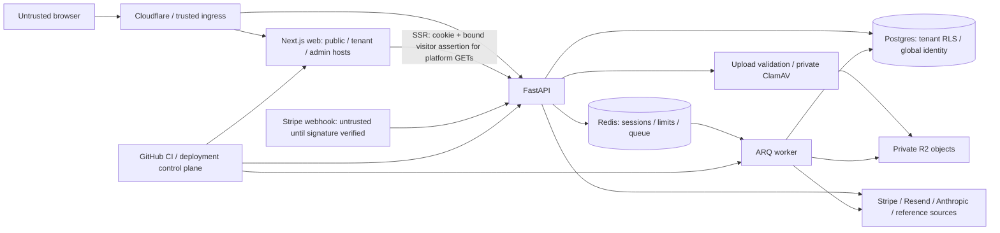

# Security threat model

Reviewed for T21.2 on 2026-11-13 against the current `dev` implementation. This is a design
review, not evidence of a penetration test or deployed infrastructure verification. The requirements
are in `plan.md` §4; service topology is in [architecture.md](architecture.md).

## Scope and security objectives

The model covers the public website and tools, tenant HR app, platform administration, FastAPI,
Postgres, Redis/ARQ worker, file processing, integrations and the build/deployment pipeline.
Protect confidentiality of employee and applicant records, prevent unauthorised changes to HR,
compliance and billing decisions, preserve attributable audit history, and keep sign-in and normal
company operations available. Cross-company disclosure and platform privilege escalation have the
highest impact. Public reference data is public; unpublished imports and tenant annotations are not.

Attackers include anonymous bots, malicious applicants, authenticated employees or company admins
trying to cross their scope, compromised platform accounts, and malicious content or dependencies.
A stolen provider, CI, database-owner or worker credential is a separate high-impact compromise.
A trusted administrator can still abuse authorised access; audit and access review reduce that risk
but do not prevent every abuse. A user's compromised browser or downloaded copy is outside the
server's control; short-lived links and minimal responses limit exposure before that point.

## Assets

| ID | Asset and location | Required protection |
|---|---|---|
| A1 | Employee/applicant identity, NI, bank, passport/visa/CoS, salary, sickness, attendance and location; tenant Postgres rows and files | Tenant and record scope; sensitive fields encrypted and masked; health data restricted; no restricted data to AI. |
| A2 | Password hashes, TOTP secrets/recovery codes, verification/invitation/reset tokens; global identity tables | Prevent takeover, enumeration and token replay; hash tokens/recovery codes, encrypt TOTP, never log credentials. |
| A3 | Tenant, platform and support bearer cookies; Redis session records | Prevent theft/fixation and cookie-type substitution; explicit expiry, rotation and revocation. |
| A4 | Memberships, RBAC grants, company status, support authorisations and platform levels | Server-side enforcement; no client-controlled privilege or company context. |
| A5 | Audit events, job/email metadata, operational logs and error telemetry | Attributable actions, append-only audit through ordinary application access, minimal personal data and bounded retention. |
| A6 | Private R2 files, generated PDFs/archives/exports, backups and encryption key history | Authorised issuance and download, malware checks, expiry, deletion and recoverability; backup credentials separated. |
| A7 | Billing customer/subscription/payment identifiers, entitlements, webhook events | Signed and idempotent updates bound to the correct company; browser success redirects cannot confer payment. No raw card storage. |
| A8 | Public SOC/rules/register/place/company datasets, calculator rates, authored learning/policy content | Integrity, provenance and controlled publication; bounded import/parse resources and escaped rendering. |
| A9 | Service credentials, encryption/blind-index keys, SSR/ingress signing secrets, CI/deployment credentials and artefacts | Server-only use, scoped credentials, environment separation, rotation and a trusted release chain. |

## Data flows and trust boundaries

| Boundary | Trust rule and implementation evidence |
|---|---|
| B1: Internet → ingress → web/API | Treat all input, Host values, IDs, cookies and forwarded headers as untrusted. `web/proxy.ts` and `web/lib/security/hosts.ts` separate hosts; `api/app/core/client_ip.py` accepts forwarding only through configured trusted proxies. Production needs HTTPS, WAF and private/restricted origins; those are operator controls, not proved by local tests. |
| B2: browser → authenticated API | API session and permission dependencies are authoritative, including for direct API calls. Unsafe methods require double-submit CSRF; CORS allows configured web/admin origins with credentials, no wildcard (`api/app/core/csrf.py`, `api/app/main.py`). All routes under `/api/v1/webhooks/` bypass CSRF and therefore must authenticate independently. |
| B3: web SSR → platform API | Next.js is a separate identity assertion issuer, not a database or tenant-authorisation bypass. Ingress must overwrite `X-Platform-Visitor-IP` and `X-Platform-Ingress-Key`, and block origin bypass. Web verifies `PLATFORM_INGRESS_SECRET`, then signs GET assertions with a separate `PLATFORM_SSR_SECRET`. API checks HMAC, ±30-second timestamp, method, path/query and cookie hash before using visitor identity (`web/lib/platform/visitor.ts`, `api/app/modules/rbac/visitor.py`). Ordinary browser API calls use the trusted socket/proxy chain. |
| B4: identity → company → record | Session membership selects company; `require()` enforces permission and own/reports scope. `TenantSession` stamps writes and scopes queries, reapplying transaction-local company/user settings after commits; non-owner `app_user` RLS adds isolation (`api/app/modules/rbac/deps.py`, `api/app/db/session.py`, `api/app/db/rls.py`). Global identity/reference data is deliberately separate. UUID secrecy is not authorisation. |
| B5: tenant → platform/support | Tenant, platform and support cookies have separate names and session types. Platform access requires live platform membership, mandatory MFA, current terms and optional IP allowlist; access is audited. Support is one-company, 30 minutes, initially read-only, with reason/ticket and dual tenant/platform audit; enabling writes is owner-only with step-up (`api/app/modules/rbac/platform.py`, `api/app/modules/support/`). |
| B6: API/worker → private infrastructure | Postgres, Redis and ClamAV must remain private. Runtime API uses non-owner database connections; migration/maintenance and some worker operations use owner privileges. `api/app/jobs/worker.py` constructs an owner engine when configured: worker or owner credential compromise crosses the RLS boundary. It must not be treated as an ordinary tenant request. |
| B7: untrusted bytes → parser/scanner → storage → download | API streams and checks uploads before storage; ClamAV failure refuses uploads. Random object keys stay private; API checks file ownership/permission and clean state before issuing 60-second GET links (`api/app/modules/files/service.py`, `validation.py`, `api/app/integrations/storage.py`). CV/CSV/Office/PDF parsers and public application uploads are attack surfaces too. |
| B8: API/worker ↔ external services | Credentials and calls remain server-side, with integration-specific timeouts, validation and idempotency. Stripe inbound raw bytes need signature/freshness verification. External reference pages, redirects, files and AI output remain untrusted even when the service is legitimate. AI sends scrubbed, pseudonymised data only. |
| B9: source → CI/build → deployed services/telemetry | Review, pinned CI actions, secret/dependency scans and public-env/bundle checks protect artefacts. Only approved public variables enter browser assets; server signing secrets stay server-side. Logs/telemetry and backups are separate disclosure paths needing scrubbers, retention and restricted access. |

## Deployment assumptions and limits

- Staging and production use distinct credentials, private data stores/ClamAV, HTTPS and restricted
  ingress. Cloudflare WAF and auth rate limits must be configured at the edge. A public origin or
  incorrectly trusted proxy invalidates B1/B3. An empty `ADMIN_IP_ALLOWLIST` means no IP restriction.
- `PLATFORM_INGRESS_SECRET` belongs to trusted ingress and web; `PLATFORM_SSR_SECRET` belongs to
  web and API. Neither is a browser value or a third-party integration key. This is the implemented
  extension to the older “web holds no secrets” wording in `plan.md` §4.1; see the C3.2.3 decision
  in `.agent/decisions.md` and the ingress contract in `deployment-requirements.txt`.
- RLS protects against missing filters, not arbitrary SQL execution as the application role, which
  could change the company setting. Owners can bypass policies. Ordinary append-only audit guards
  cannot withstand a compromised database owner; authorised maintenance/deletion paths are privileged.
- Parent-domain cookies make all sibling subdomains part of the trust model. Do not host untrusted
  apps or allow dangling DNS there; SameSite and CORS do not make a compromised sibling safe.
- A presigned URL is a bearer capability until expiry. Revoking an app session cannot revoke an
  already downloaded file or immediately invalidate an issued URL. Avoid logging these URLs.
- Encrypted fields still need access control; API/worker possession of the keys allows decryption.
  Loss of key history makes older ciphertext/backups unreadable. Follow
  [key-rotation.md](runbooks/key-rotation.md), keeping old keys until affected backups expire.
- This document records code-level controls, not deployed acceptance. See the follow-up register
  below for scans, retention and recovery evidence still required before launch.

## Existing implementation notes

## Content Security Policy

- Scripts use a per-request nonce plus `strict-dynamic`; there is no `'unsafe-inline'` for scripts (`web/lib/security/csp.ts`).
- `<style>` elements use the nonce too.
- **Accepted exception:** `style-src-attr 'unsafe-inline'`. The animation library sets `style` attributes at run time (transforms and opacity while a layer opens, closes or slides), and a nonce cannot be attached to an attribute. It allows inline `style="..."` attributes only; it does not allow `<style>` elements or any script. Components may not use the `style` prop themselves (an ESLint rule bans it), so the exception is not used by our own markup. Decided by the owner on 2026-11-02.

### The visitor's IP address

`X-Real-IP` and `CF-Connecting-IP` are believed only when the connection comes from a trusted proxy
(`api/app/core/client_ip.py`). In production that is Railway's private network (override with
`TRUSTED_PROXY_CIDRS`); `CF-Connecting-IP` counts only when Railway reports that the connection to
it came from one of Cloudflare's published ranges (the weekly worker job fetches cloudflare.com/ips-v4 and /ips-v6 into Redis and the API rereads them hourly; a reply that does not look like the list is refused; the copy in `core/client_ip.py`, checked 2026-11-02, is the fallback).
Everywhere else, including a developer machine, the socket address is used and the headers are
ignored, so a forged header cannot dodge a rate limit or poison the audit trail.

### Request bodies

Every JSON request model inherits `RequestModel` (`api/app/core/schemas.py`), which refuses fields it
does not declare. A test walks the OpenAPI document and fails for any request body that does not.

### AI requests (T14.4)
- Only the API calls Anthropic (`api/app/integrations/anthropic.py`); with no `ANTHROPIC_API_KEY`, or the company's AI switch off, nothing is sent.
- `app.ai.redaction.scrub` drops restricted keys (NI, bank, passport/visa/BRP, share code, CoS, health/sickness, salary, address, date of birth, contact details), labels names (`Employee A`) and redacts identifier-like text; `assert_clean` checks the exact wire body and refuses to send if anything survives.
- Usage is logged in `ai_interactions` as metadata only (feature, model, status, token counts, duration). Rate limit: 30 per hour per user.

## STRIDE by component

S = spoofing, T = tampering, R = repudiation, I = information disclosure, D = denial of service,
E = elevation of privilege. Each component considers all six categories. “Control” means a current
code mechanism or an explicitly identified deployment requirement; residual threats remain subject
to the verification register. Impact is greatest when A1, A4 or A9 crosses a company/platform boundary.

### C1: ingress, Next.js, public pages and tools (B1–B3, A3/A8/A9)

| Category | Threat → control and remaining exposure |
|---|---|
| S | Forge Host or visitor IP to enter admin pages or evade limits → host routing, trusted-proxy checks and authenticated SSR assertions. Origin restriction and header overwrite must be verified in deployment. |
| T | Inject script/HTML through public content, query strings or API values → React escaping and nonce CSP; authored MDX remains trusted code requiring review. No untrusted MDX compilation. |
| R | Poison request IDs or SSR audit identity → bounded request-ID syntax and signed visitor identity; request IDs are correlation values, not proof of identity. |
| I | Leak private SSR responses through caching or browser bundles → authenticated server fetches must not share private cache entries; public-env allowlist and bundle scanner reject secret exposure. Review cache use whenever a public page starts using a session. |
| D | Flood public SOC/register/contact/search or expensive SSR requests → public endpoint rate limits, API body limits and bounded queries; edge WAF/rate limiting is an additional deployment dependency. |
| E | XSS steals same-origin authority or clickjacking triggers privileged actions → CSP, frame denial, HttpOnly cookies and API permissions/step-up. CSRF/CORS cannot contain arbitrary same-origin script execution. |

Evidence: `web/proxy.ts`, `web/lib/security/`, `web/lib/platform/visitor.ts`,
`scripts/check-public-env.mjs`, `scripts/scan-bundle.mjs`,
`api/tests/test_client_ip.py`, `api/tests/db/test_register_public.py`,
`api/tests/db/test_contact_public.py`, `web/tests/e2e/security-headers.spec.ts`.
The accepted style-attribute exception is explained above; development CSP is intentionally weaker
and is not production evidence.

### C2: authentication and session lifecycle (B2/B5, A2/A3/A4)

| Category | Threat → control and remaining exposure |
|---|---|
| S | Credential stuffing, phishing or replay of reset/invite/recovery tokens → Argon2id, breached/common-password checks, MFA policy, hashed single-use tokens and rate limits/lockout. MFA does not stop theft of a live session. |
| T | Fix a session before login/MFA/company change, alter cookie claims, or submit forged state changes → opaque server-side sessions, rotation and CSRF checks; no client-supplied role claims. |
| R | Deny a login, reset or privilege change → auth audit events and session history with actor/IP/request ID; trusted IP forwarding remains essential. |
| I | Enumerate email accounts or expose token/password/TOTP material → generic auth responses, hashed tokens, encrypted TOTP, masked settings and log scrubbing. Do not put tokens into telemetry. |
| D | Exhaust password-hash CPU or lock out victims → per-IP/account limits, body bounds and progressive lockout. Distributed abuse and deliberate victim lockout still need edge monitoring. |
| E | Reuse a tenant token as platform/support, bypass MFA policy or retain revoked membership → separate session types and cookies, current user/membership checks and recent step-up for sensitive actions. |

Evidence: `api/app/modules/auth/`, `api/app/core/totp.py`, `api/app/core/rate_limit.py`,
`api/tests/db/test_auth_flows.py`, `api/tests/db/test_auth_endpoints.py`,
`api/tests/db/test_tenant_session.py`, `api/tests/db/test_platform_session.py`.
Tenant sessions are idle-limited to 8 hours and absolute-limited to 14 days; platform absolute
lifetime is 8 hours, support lifetime 30 minutes and the step-up window 10 minutes.

### C3: tenant business API and Postgres (B4/B6, A1/A4/A5)

| Category | Threat → control and remaining exposure |
|---|---|
| S | Submit another company/employee ID or impersonate a reporting authority → company from authenticated membership, server permission/own/reports checks and RLS; leave sanctioning authority is a distinct relationship. |
| T | Mass-assign roles/company IDs, inject SQL or move a row across tenants → strict request schemas, parameterised queries, write stamping and transaction-local company scope. Raw SQL is confined to `app/db/`. |
| R | Change employment, pay, attendance or compliance records without attribution → transactional audit events with masked changes and database append-only guards for ordinary roles. Owner operations remain privileged. |
| I | IDOR via detail/list/search/report/export, unmasked sensitive fields or unsafe database views → application scope plus RLS, 404 for foreign records, projection/masking and explicit reveal checks; drift checks reject unsafe views/functions. |
| D | Expensive joins, unbounded exports or pool exhaustion → pagination, bounded request bodies and background report/export jobs; performance budgets and database capacity need separate verification. |
| E | Missing permission guard, overbroad own/reports access or runtime owner credentials → declared RBAC dependencies, role/tenant guard tests and non-owner API role. RLS does not protect against arbitrary SQL or a stolen owner key. |

Evidence: `api/app/core/rbac_matrix.py`, `api/app/core/schemas.py`, `api/app/modules/rbac/`,
`api/app/db/session.py`, `api/app/db/rls.py`, `api/tests/test_architecture.py`,
`api/tests/test_openapi.py`, `api/tests/db/test_rls_isolation.py`,
`api/tests/db/test_rbac_enforcement.py`, `api/tests/db/test_report_projections.py`.
Endpoint-by-endpoint coverage expansion belongs to T21.1; adversarial IDOR testing belongs to T21.4.

### C4: platform administration and support (B3/B5/B6, A1/A4/A5/A9)

| Category | Threat → control and remaining exposure |
|---|---|
| S | Stolen tenant cookie or forged SSR visitor obtains platform access → separate MFA-backed platform session and live platform membership; GET assertions are signed and bound to cookie/target/time. Valid assertions can be replayed within their brief bound window if stolen. |
| T | Turn on support writes, change billing or run arbitrary worker code → owner/step-up checks where required, explicit support write toggle and named job rerun allowlist with reason. |
| R | Admin denies inspecting a company → committed `platform.access` events even when handlers fail, plus support events in both tenant/platform trails with reason and ticket. Audit storage remains within the operator's trust boundary. |
| I | Support session exposes another company or outlives expiry → one-company support context, live 30-minute session checks and explicit exit; privileged read access is still inherently sensitive. |
| D | Repeated manual imports/job reruns/refunds overload services → guarded rerun allowlist, ingest locking and idempotency; monitor authorised admin abuse as well as anonymous traffic. |
| E | Support-level admin performs owner actions or support bypasses normal tenant write restrictions → level checks, read-only default, separate cookies and API enforcement. Optional IP restriction is absent when its allowlist is empty. |

Evidence: `api/app/modules/rbac/platform.py`, `api/app/modules/support/`,
`api/app/modules/platform_admin/`, `api/app/jobs/rerun.py`,
`api/tests/db/test_platform_admin.py`, `api/tests/db/test_platform_ssr.py`,
`api/tests/db/test_support_mode.py`, `web/lib/platform/visitor.test.ts`.
The separate `platform_admin_rw` database role required by plan §4.3 is not provisioned in
`api/app/db/roles.py`; current platform code uses guarded global/company-scoped sessions.
This is a requirement gap for follow-up, not evidence that an independent database role exists.

### C5: files, CVs, generated documents and exports (B7, A1/A6)

| Category | Threat → control and remaining exposure |
|---|---|
| S | Rename executable bytes to PDF or request another employee's file → extension plus magic/type checks, owner/permission checks and clean-state validation. A random object key alone grants no application permission. |
| T | Path traversal, header injection, malicious Office/PDF content or altered archive membership → sanitised filenames, server-generated object keys, ZIP entry/uncompressed limits and ClamAV before storage. Parser vulnerabilities remain a dependency risk. |
| R | Deny upload rejection, download-link issuance or export creation → file/export audit events and job status. Object delivery using an already issued URL is outside API request attribution. |
| I | Public bucket, leaked presign or cross-company export → private storage, tenant-bound archive selection, short-lived GET links and attachment/no-store responses. Links and downloaded copies remain bearer/user-controlled. |
| D | Oversized upload, ZIP bomb, broken scanner or repeated document generation → streaming 25 MiB default limit, ZIP bounds, API body limits and background generation; scanner failure rejects upload rather than silently accepting. |
| E | Malicious upload becomes executable app content or a download endpoint bypasses its owner scope → extension/type allowlist, attachment delivery and per-owner checks; public recruitment uploads need their own bounded anonymous access path. |

Evidence: `api/app/modules/files/`, `api/app/integrations/clamav.py`,
`api/app/integrations/storage.py`, `api/app/modules/exports/archive.py`,
`api/tests/db/test_files.py`, `api/tests/db/test_export_isolation.py`,
`api/tests/test_soc_cv.py`, `api/tests/test_body_limits.py`.

### C6: Redis, worker, scheduled jobs and email (B6/B8, A1/A3/A5/A6/A9)

| Category | Threat → control and remaining exposure |
|---|---|
| S | Untrusted producer injects a queue job or changes a cached session → Redis must be private with restricted credentials; worker registers named functions. Redis compromise allows session/queue tampering despite token hashing. |
| T | Replay jobs, alter recipient/company or execute destructive maintenance with the wrong scope → explicit job inputs, tenant sessions, idempotent operations and restricted rerun names; owner-engine jobs demand additional review. |
| R | Background action lacks request actor or disappears after failure → tracked job audit, rerun reasons and email outbox status. Confirm failure monitoring in deployment. |
| I | Wrong-tenant report, emailed secrets, queue payload/log leakage or backup exposure → scoped report/export work, email templates and log redaction; private infrastructure and backup access are required. |
| D | Retry storm, email flood, import lock contention or worker outage → bounded concurrency/timeouts, retry schedules and ingest locks. Queue backlog and cron freshness need operational alerts. |
| E | Queue/parser execution compromises owner DB engine or outbound provider keys → isolate worker/network/credentials; registered functions are not a sandbox. Worker compromise has cross-company impact and can bypass RLS. |

Evidence: `api/app/jobs/worker.py`, `api/app/jobs/scheduled.py`, `api/app/jobs/audit.py`,
`api/app/modules/email/outbox.py`, `api/app/jobs/deletion.py`,
`api/tests/db/test_worker.py`, `api/tests/db/test_email.py`, `api/tests/db/test_deletion.py`.
Account deletion is implemented; routine retention and nightly backup schedule entries are still
`_nothing_yet` placeholders and cannot count as functioning controls.

### C7: Stripe and billing webhooks (B2/B8, A7/A9)

| Category | Threat → control and remaining exposure |
|---|---|
| S | Forge provider events or a successful checkout return → verify signature over raw bytes with the endpoint secret; entitlement follows server-side billing state, not browser claims. |
| T | Replay/reorder events, substitute company/customer or duplicate refunds → event-ID deduplication, company/customer binding and outbound idempotency keys. Verify real provider schema/order behaviour in Stripe test mode. |
| R | Dispute subscription/refund action → billing audit plus stored event IDs and provider records; preserve correlation without logging payload secrets. |
| I | Leak keys/card details through browser/error responses → server-only restricted key, hosted Checkout/Portal and safe integration errors. Provider account access remains independently sensitive. |
| D | Flood webhook parsing, force retry storms or lose provider connectivity → body limits, signature checks, bounded outbound retries/timeouts and idempotent retry processing. Provider outages can delay billing convergence. |
| E | Use webhook or billing manager endpoint to grant another company's plan → signed event validation and server billing permission/company checks; refund and plan operations need their prescribed owner/step-up checks. |

Evidence: `api/app/integrations/stripe.py`, `api/app/modules/billing/`,
`api/tests/test_stripe.py`, `api/tests/db/test_billing.py`, `leftover.md` L1.
Signature freshness tolerance is 300 seconds; event deduplication is still required inside that window.
Any new webhook under the CSRF-exempt prefix needs an equivalent independent authentication design.

### C8: reference data, external fetches and publication (B8, A8/A9)

| Category | Threat → control and remaining exposure |
|---|---|
| S | Replace GOV.UK/ONS/Companies House material with an attacker URL → fixed integration origins and validated source URLs; publication identity/provenance must stay visible. |
| T | Poison CSV/rules data, insert duplicate/ambiguous company names or publish stale rates → source hashes, import validation, staging/publish workflow where supported and conservative matching. A legitimate upstream can still contain errors. |
| R | Deny publishing a rules version or running an import → version/hash/source metadata and job/platform audit trails. |
| I | SSRF reaches internal metadata or leaks provider credentials through redirects → allowlisted destinations and bounded integration fetchers; redirect/DNS/private-address handling must be reviewed in T21.4 for every fetch path. Do not infer safety from the initial URL alone. |
| D | Multi-million-row dataset, decompression bomb or huge remote response → streaming/bounded parsing, download limits and import locks; schema/size changes can still exhaust resources or delay updates. |
| E | Public data becomes executable markup or imports gain arbitrary SQL/file access → parsed fields, escaped rendering, controlled publication and parser dependency scans. Operator-imported files remain untrusted bytes. |

Evidence: `api/app/modules/register/ingest.py`, `api/app/modules/register/geo.py`,
`api/app/modules/soc/source.py`, `api/app/integrations/companies_house.py`,
`api/app/integrations/postcodes.py`, `api/tests/test_register_ingest.py`,
`api/tests/db/test_register_geo.py`, `docs/runbooks/register-companies.md`.

### C9: AI drafting and matching (B8, A1/A5/A9)

| Category | Threat → control and remaining exposure |
|---|---|
| S | Prompt impersonates a system instruction or forges an employee identity → server task/prompt construction, scoped input data and pseudonym labels. Prompt text is not an identity or permission source. |
| T | Prompt injection or hallucination changes HR/compliance output → treat responses as untrusted suggestions requiring human review; no direct tool, SQL or privileged action authority from model output. Redaction does not ensure factual accuracy. |
| R | Cannot explain which AI feature produced a draft → metadata-only interaction record (feature/model/status/token counts/duration). Intentionally no stored prompt/answer means limited content reconstruction. |
| I | Names, identifiers, health or salary leave the tenant through free text → recursive restricted-key scrub, name labels, identifier redaction and final wire-body `assert_clean`. Unrecognised free-text personal data remains a residual risk requiring payload review. |
| D | Cost/latency exhaustion → 30 requests/hour/user, output token bounds and provider timeout/error handling; per-user limits do not cap all-company provider spend. |
| E | AI bypasses disabled-company flags or broadens a user's access → key/platform/company gates and existing API access scope; no AI authority to grant roles or execute actions. |

Evidence: `api/app/ai/service.py`, `api/app/ai/redaction.py`,
`api/app/integrations/anthropic.py`, `api/tests/test_ai_redaction.py`.
No key means no AI call and non-AI paths remain available. Deployed settings currently require the
key, so keeping AI disabled there also requires the platform/company switches. Ask Mady remains deferred.

### C10: CI, configuration, logs, telemetry and recovery (B9, A5/A6/A9)

| Category | Threat → control and remaining exposure |
|---|---|
| S | Impersonate a maintainer/deployer or substitute a CI action → protected repository/provider accounts and reviewed, pinned workflow actions. Branch/account protections need operator verification. |
| T | Malicious dependency/build, stolen deployment token or modified backup → CI dependency/container/static/secret scanning and reviewed lockfiles; scoped deploy credentials and encrypted independent backups are required. Scanning cannot prove supply-chain integrity. |
| R | Unattributed release or lost incident evidence → Git/PR/CI history, structured request IDs and job/platform audit; operator log access and retention must be verified. |
| I | Secrets in source, public env, build artefacts, logs/Sentry or backups → SecretStr, pre-commit/CI secret checks, bundle allowlist/scan, sensitive-key and URL-credential scrubbing. Sentry configuration names/CSP permissions alone do not establish a working PII scrubber. |
| D | Deployment failure, database/key loss, unavailable Redis or corrupt backup → startup configuration validation and readiness checks; restore tests, key escrow and real backup jobs are still required recovery evidence. |
| E | CI or database owner compromise changes every tenant despite API RBAC → least-privilege environment credentials, restricted production access and review; ordinary app audit/RLS cannot contain this compromise. |

Evidence: `.pre-commit-config.yaml`, `.github/workflows/ci.yml`,
`.github/workflows/security.yml`, `api/app/core/config.py`, `api/app/core/logging.py`,
`api/app/modules/audit/service.py`, `api/tests/test_logging.py`, `api/tests/test_config.py`,
`scripts/tests/`, `docs/runbooks/key-rotation.md`.

## Verification and unresolved risk register

This register assigns existing plan work; it does not assert that a future block is complete or
replace `micro_plan.md`/`leftover.md`. Pending launch controls are not accepted production exceptions.

| Item | Current evidence or limitation | Required follow-up / responsible block |
|---|---|---|
| V1: route guards and tenant isolation | RBAC/RLS and area-specific tests exist; endpoint inventory expansion is separate work. | T21.1: every-endpoint matrix; T21.4: foreign IDs, own/reports, mass assignment and session attacks. |
| V2: deployed ingress and web hardening | Code enforces nonce CSP and signed SSR identity. Edge/origin access, cookie/TLS behaviour and optional admin allowlist need real environment evidence. | T21.3/T21.4 and Phase 23 deployment: verify header overwrite, origin restriction and proxy chain, production headers and disabled dev relaxations. |
| V3: scans and staging baseline | CI scan workflows exist. ZAP explicitly skips without `STAGING_URL`; a skipped job is not a clean scan and a passive baseline is not an authenticated pen-test. | T21.3: dependency/container/secret results; Phase 23: configure staging and retain actual ZAP evidence. T21.4: adversarial checks. |
| V4: database privilege separation | API uses `app_user`; worker constructs owner engine; planned `platform_admin_rw` role is absent. | T21.4/T25.3: review minimum grants and platform/maintenance boundaries, implement required separation or record an explicit reviewed plan decision before launch. |
| V5: retention and backups | `api/app/jobs/scheduled.py` still registers placeholder nightly backup and daily retention functions; no `docs/runbooks/restore.md` exists. Deletion executor is real but does not establish complete backup erasure. | T21.5 and deployment acceptance: implement/verify retention, encrypted separate-bucket backup with specified expiry, restore runbook and measured restore/key recovery. |
| V6: telemetry and privacy | Log scrubbing tests exist; Sentry SDK/scrubber integration is not established by current settings. Legal notices remain drafts and acknowledge retention gaps. | T21.5: data map, actual telemetry scrubbing, processor/region/retention approval and export/deletion verification; do not enable unsanitised telemetry. |
| V7: Stripe live integration contract | Mocked signature/billing tests exist; L1 test-mode flows and API-version/schema confirmation are parked. | `leftover.md` L1 before Phase 23: test both plans, refunds, cancellation, failed payment and replay using real test-mode credentials. |
| V8: parser/SSRF and public abuse | Typed requests, upload validation and reference import tests exist; none proves every parser/fetch path safe. | T21.4: redirects, private targets, path traversal, malformed/oversized archives, public upload abuse and XSS; T21.3 for dependency vulnerabilities. |
| V9: AI disclosure and output | Scrubbers/final payload checks and gates exist; heuristic redaction cannot guarantee removal of all free-text personal data. | T21.5: inspect exact outbound payloads and provider terms; keep disabled until approved, keep human review for drafts/matches. |

Update this model when adding a route/session type, tenant table, privileged job, external fetch,
subdomain, upload parser, AI feature or telemetry sink. Review the affected boundary and all six
STRIDE categories, link the enforcing code and negative test, and keep unverified deployment claims
in this register. Phase 21/22 audit and T25.3 use this model as their review checklist.
