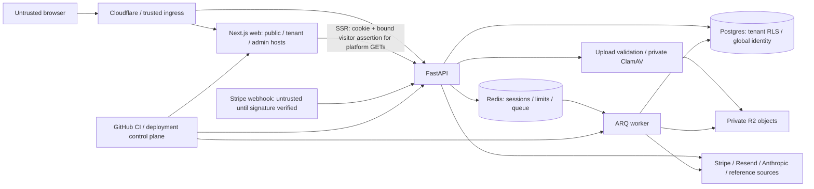

# Security threat model

Reviewed for T21.2 on 2026-11-13 against the current `dev` implementation. This is a design
review, not evidence of a penetration test or deployed infrastructure verification. The requirements
are in `plan.md` §4; service topology is in [architecture.md](architecture.md).

## Scope and security objectives

The model covers the public website and tools, tenant HR app, platform administration, FastAPI,
Postgres, Redis/ARQ worker, file processing, integrations and the build/deployment pipeline.
Protect confidentiality of employee and applicant records, prevent unauthorised changes to HR,
compliance and billing decisions, preserve attributable audit history, and keep sign-in and normal
company operations available. Cross-company disclosure and platform privilege escalation have the
highest impact. Public reference data is public; unpublished imports and tenant annotations are not.

Attackers include anonymous bots, malicious applicants, authenticated employees or company admins
trying to cross their scope, compromised platform accounts, and malicious content or dependencies.
A stolen provider, CI, database-owner or worker credential is a separate high-impact compromise.
A trusted administrator can still abuse authorised access; audit and access review reduce that risk
but do not prevent every abuse. A user's compromised browser or downloaded copy is outside the
server's control; short-lived links and minimal responses limit exposure before that point.

## Assets

| ID | Asset and location | Required protection |
|---|---|---|
| A1 | Employee/applicant identity, NI, bank, passport/visa/CoS, salary, sickness, attendance and location; tenant Postgres rows and files | Tenant and record scope; sensitive fields encrypted and masked; health data restricted; no restricted data to AI. |
| A2 | Password hashes, TOTP secrets/recovery codes, verification/invitation/reset tokens; global identity tables | Prevent takeover, enumeration and token replay; hash tokens/recovery codes, encrypt TOTP, never log credentials. |
| A3 | Tenant, platform and support bearer cookies; Redis session records | Prevent theft/fixation and cookie-type substitution; explicit expiry, rotation and revocation. |
| A4 | Memberships, RBAC grants, company status, support authorisations and platform levels | Server-side enforcement; no client-controlled privilege or company context. |
| A5 | Audit events, job/email metadata, operational logs and error telemetry | Attributable actions, append-only audit through ordinary application access, minimal personal data and bounded retention. |
| A6 | Private R2 files, generated PDFs/archives/exports, backups and encryption key history | Authorised issuance and download, malware checks, expiry, deletion and recoverability; backup credentials separated. |
| A7 | Billing customer/subscription/payment identifiers, entitlements, webhook events | Signed and idempotent updates bound to the correct company; browser success redirects cannot confer payment. No raw card storage. |
| A8 | Public SOC/rules/register/place/company datasets, calculator rates, authored learning/policy content | Integrity, provenance and controlled publication; bounded import/parse resources and escaped rendering. |
| A9 | Service credentials, encryption/blind-index keys, SSR/ingress signing secrets, CI/deployment credentials and artefacts | Server-only use, scoped credentials, environment separation, rotation and a trusted release chain. |

## Data flows and trust boundaries

| Boundary | Trust rule and implementation evidence |
|---|---|
| B1: Internet → ingress → web/API | Treat all input, Host values, IDs, cookies and forwarded headers as untrusted. `web/proxy.ts` and `web/lib/security/hosts.ts` separate hosts; `api/app/core/client_ip.py` accepts forwarding only through configured trusted proxies. Production needs HTTPS, WAF and private/restricted origins; those are operator controls, not proved by local tests. |
| B2: browser → authenticated API | API session and permission dependencies are authoritative, including for direct API calls. Unsafe methods require double-submit CSRF; CORS allows configured web/admin origins with credentials, no wildcard (`api/app/core/csrf.py`, `api/app/main.py`). All routes under `/api/v1/webhooks/` bypass CSRF and therefore must authenticate independently. |
| B3: web SSR → platform API | Next.js is a separate identity assertion issuer, not a database or tenant-authorisation bypass. Ingress must overwrite `X-Platform-Visitor-IP` and `X-Platform-Ingress-Key`, and block origin bypass. Web verifies `PLATFORM_INGRESS_SECRET`, then signs GET assertions with a separate `PLATFORM_SSR_SECRET`. API checks HMAC, ±30-second timestamp, method, path/query and cookie hash before using visitor identity (`web/lib/platform/visitor.ts`, `api/app/modules/rbac/visitor.py`). Ordinary browser API calls use the trusted socket/proxy chain. |
| B4: identity → company → record | Session membership selects company; `require()` enforces permission and own/reports scope. `TenantSession` stamps writes and scopes queries, reapplying transaction-local company/user settings after commits; non-owner `app_user` RLS adds isolation (`api/app/modules/rbac/deps.py`, `api/app/db/session.py`, `api/app/db/rls.py`). Global identity/reference data is deliberately separate. UUID secrecy is not authorisation. |
| B5: tenant → platform/support | Tenant, platform and support cookies have separate names and session types. Platform access requires live platform membership, mandatory MFA, current terms and optional IP allowlist; access is audited. Support is one-company, 30 minutes, initially read-only, with reason/ticket and dual tenant/platform audit; enabling writes is owner-only with step-up (`api/app/modules/rbac/platform.py`, `api/app/modules/support/`). |
| B6: API/worker → private infrastructure | Postgres, Redis and ClamAV must remain private. Runtime API uses non-owner database connections; migration/maintenance and some worker operations use owner privileges. `api/app/jobs/worker.py` constructs an owner engine when configured: worker or owner credential compromise crosses the RLS boundary. It must not be treated as an ordinary tenant request. |
| B7: untrusted bytes → parser/scanner → storage → download | API streams and checks uploads before storage; ClamAV failure refuses uploads. Random object keys stay private; API checks file ownership/permission and clean state before issuing 60-second GET links (`api/app/modules/files/service.py`, `validation.py`, `api/app/integrations/storage.py`). CV/CSV/Office/PDF parsers and public application uploads are attack surfaces too. |
| B8: API/worker ↔ external services | Credentials and calls remain server-side, with integration-specific timeouts, validation and idempotency. Stripe inbound raw bytes need signature/freshness verification. External reference pages, redirects, files and AI output remain untrusted even when the service is legitimate. AI sends scrubbed, pseudonymised data only. |
| B9: source → CI/build → deployed services/telemetry | Review, pinned CI actions, secret/dependency scans and public-env/bundle checks protect artefacts. Only approved public variables enter browser assets; server signing secrets stay server-side. Logs/telemetry and backups are separate disclosure paths needing scrubbers, retention and restricted access. |

## Deployment assumptions and limits

- Staging and production use distinct credentials, private data stores/ClamAV, HTTPS and restricted
  ingress. Cloudflare WAF and auth rate limits must be configured at the edge. A public origin or
  incorrectly trusted proxy invalidates B1/B3. An empty `ADMIN_IP_ALLOWLIST` means no IP restriction.
- `PLATFORM_INGRESS_SECRET` belongs to trusted ingress and web; `PLATFORM_SSR_SECRET` belongs to
  web and API. Neither is a browser value or a third-party integration key. This is the implemented
  extension to the older “web holds no secrets” wording in `plan.md` §4.1; see the C3.2.3 decision
  in `.agent/decisions.md` and the ingress contract in `deployment-requirements.txt`.
- RLS protects against missing filters, not arbitrary SQL execution as the application role, which
  could change the company setting. Owners can bypass policies. Ordinary append-only audit guards
  cannot withstand a compromised database owner; authorised maintenance/deletion paths are privileged.
- Parent-domain cookies make all sibling subdomains part of the trust model. Do not host untrusted
  apps or allow dangling DNS there; SameSite and CORS do not make a compromised sibling safe.
- A presigned URL is a bearer capability until expiry. Revoking an app session cannot revoke an
  already downloaded file or immediately invalidate an issued URL. Avoid logging these URLs.
- Encrypted fields still need access control; API/worker possession of the keys allows decryption.
  Loss of key history makes older ciphertext/backups unreadable. Follow
  [key-rotation.md](runbooks/key-rotation.md), keeping old keys until affected backups expire.
- This document records code-level controls, not deployed acceptance. See the follow-up register
  below for scans, retention and recovery evidence still required before launch.

## Existing implementation notes

## Content Security Policy

- Scripts use a per-request nonce plus `strict-dynamic`; there is no `'unsafe-inline'` for scripts (`web/lib/security/csp.ts`).
- `<style>` elements use the nonce too.
- **Accepted exception:** `style-src-attr 'unsafe-inline'`. The animation library sets `style` attributes at run time (transforms and opacity while a layer opens, closes or slides), and a nonce cannot be attached to an attribute. It allows inline `style="..."` attributes only; it does not allow `<style>` elements or any script. Components may not use the `style` prop themselves (an ESLint rule bans it), so the exception is not used by our own markup. Decided by the owner on 2026-11-02.

### The visitor's IP address

`X-Real-IP` and `CF-Connecting-IP` are believed only when the connection comes from a trusted proxy
(`api/app/core/client_ip.py`). In production that is Railway's private network (override with
`TRUSTED_PROXY_CIDRS`); `CF-Connecting-IP` counts only when Railway reports that the connection to
it came from one of Cloudflare's published ranges (the weekly worker job fetches cloudflare.com/ips-v4 and /ips-v6 into Redis and the API rereads them hourly; a reply that does not look like the list is refused; the copy in `core/client_ip.py`, checked 2026-11-02, is the fallback).
Everywhere else, including a developer machine, the socket address is used and the headers are
ignored, so a forged header cannot dodge a rate limit or poison the audit trail.

### Request bodies

Every JSON request model inherits `RequestModel` (`api/app/core/schemas.py`), which refuses fields it
does not declare. A test walks the OpenAPI document and fails for any request body that does not.

### AI requests (T14.4)
- Only the API calls Anthropic (`api/app/integrations/anthropic.py`); with no `ANTHROPIC_API_KEY`, or the company's AI switch off, nothing is sent.
- `app.ai.redaction.scrub` drops restricted keys (NI, bank, passport/visa/BRP, share code, CoS, health/sickness, salary, address, date of birth, contact details), labels names (`Employee A`) and redacts identifier-like text; `assert_clean` checks the exact wire body and refuses to send if anything survives.
- Usage is logged in `ai_interactions` as metadata only (feature, model, status, token counts, duration). Rate limit: 30 per hour per user.
